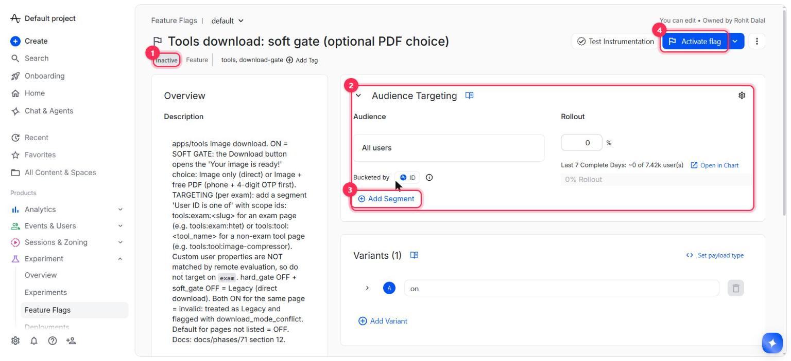
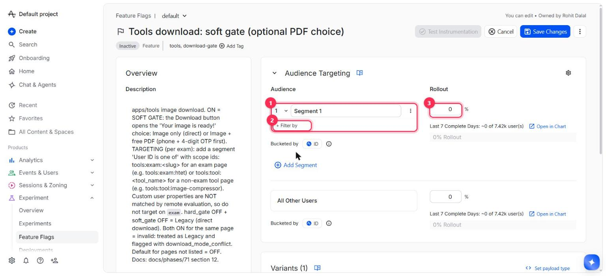
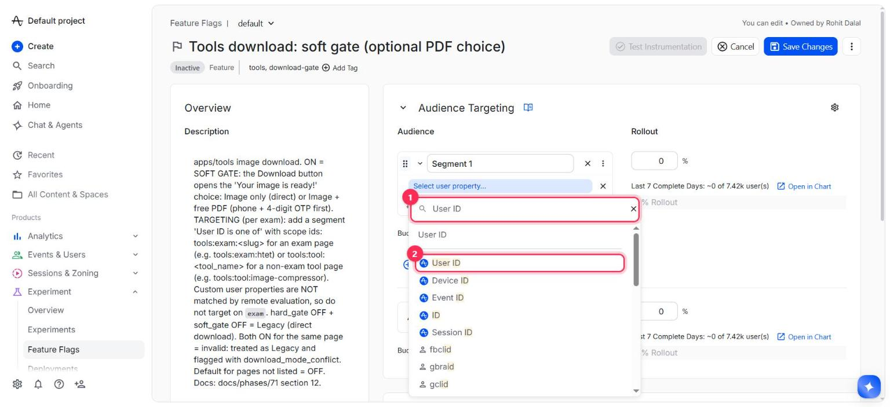
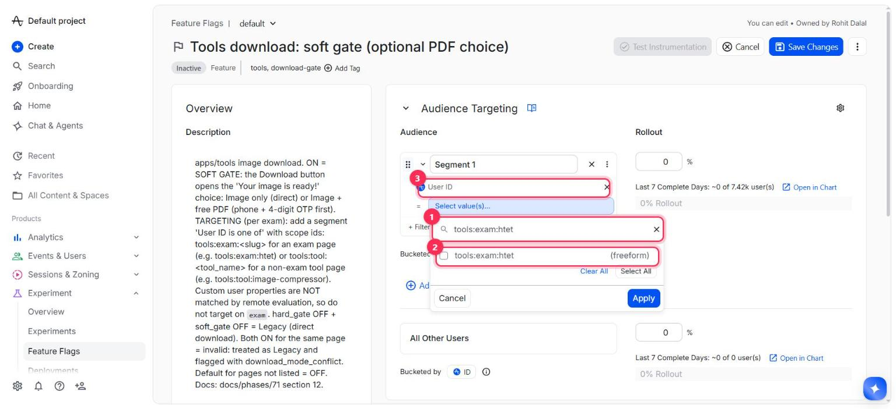
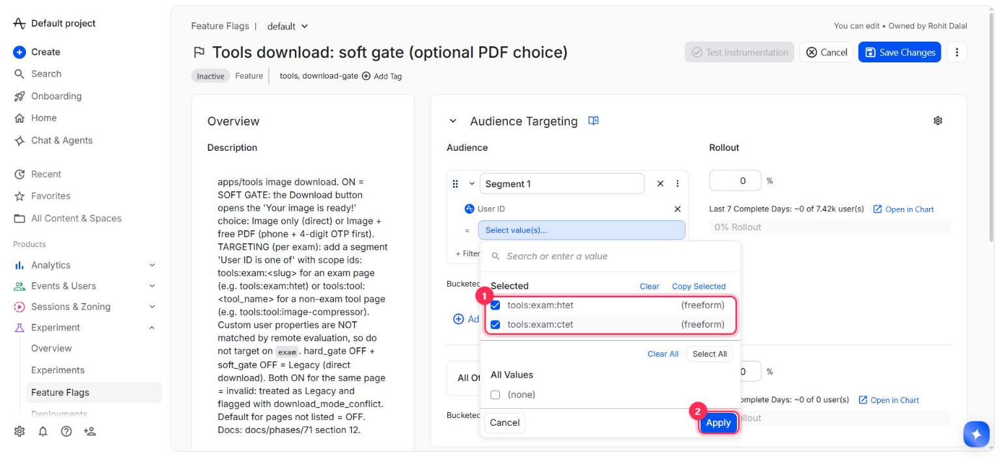
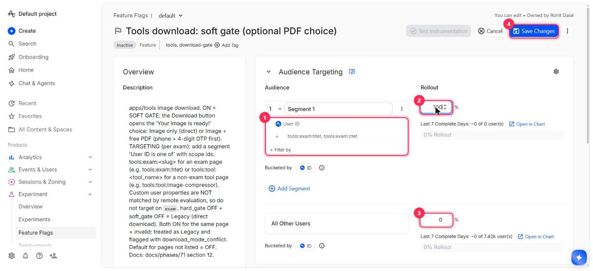

# Feature guide — Download gates per exam (Amplitude flags `hard_gate` / `soft_gate`)

How to choose, **per exam page**, what the **Download** button does in the Tools image tools (photo / signature resizer, compressors, Add Name & Date). No code change and no deploy is needed to change an exam — everything is switched in Amplitude.

| Mode | When | What the visitor sees on Download |
|---|---|---|
| **Legacy** | both flags OFF for that page (the default) | the image downloads immediately, no OTP, no popup |
| **Hard gate** | `hard_gate` ON, `soft_gate` OFF | phone number + 4-digit OTP first; the image downloads only after verification |
| **Soft gate** | `soft_gate` ON, `hard_gate` OFF | the "Your image is ready!" choice: **Download Image** (instant) or **Download Image & Get Free PDF** (phone + OTP, then the image) |

Rules worth remembering
- A page must be in **one** flag only. If the same page is in both, it is treated as **Legacy** and Amplitude gets `download_mode_conflict = true` on `Resizer Image Downloaded`.
- A page that is in **neither** flag (or whenever Amplitude cannot be reached) is **Legacy** — a download is never blocked.
- Changes reach visitors within a few minutes (answers are cached for 10 minutes per browser session).
- Technical background: `docs/phases/71-image-download-options.md` §12–13.

> **Before the first real use:** the flags are currently **Inactive with no segments** = every page is Legacy. The live site shows the soft-gate sheet today, so the day this feature is deployed it turns into Legacy until `soft_gate` is configured as below.

---

## The one thing to understand: you target a page with its "scope id"

In Amplitude you do **not** target an "exam" property (Amplitude's remote evaluation ignores custom properties). You target **User ID**, and each page sends a fixed scope id as its User ID:

| Page | Scope id to put in the segment |
|---|---|
| An exam page `clearcutoff.in/tools/resizer/<slug>` | `tools:exam:<slug>` — e.g. `tools:exam:tnpsc`, `tools:exam:htet`, `tools:exam:ctet` |
| The generic resizer page `clearcutoff.in/tools/resizer` | `tools:tool:resizer` |
| Image compressor | `tools:tool:image-compressor` |
| Signature compressor | `tools:tool:signature-compressor` |
| Add Name & Date | `tools:tool:add-name-date` |

`<slug>` is the last part of the exam page's URL, in lower case (the list is at the end of this guide). No real visitor ever has such a User ID, so a segment like this only ever affects the pages you list.

---

## Step by step (example: turn the soft gate on for HTET and CTET)

Open Amplitude → **Experiment → Feature Flags**, search for the flag and open it:
- soft gate: <https://app.amplitude.com/experiment/clear-cutoff/673721/config/1582144/configure>
- hard gate: <https://app.amplitude.com/experiment/clear-cutoff/673721/config/1582143/configure>

### 1. Open the flag

1. Status chip — **Inactive** means the flag is OFF for everybody.
2. **Audience Targeting** card — this is the only part you edit.
3. **Add Segment** — creates a targeting rule.
4. **Activate flag** — the on/off switch (you press it at the very end).

### 2. Add a segment

Click **Add Segment**. A card "Segment 1" appears (1). Click **+ Filter by** (2). Its **Rollout** box (3) is 0 % for now.

### 3. Choose the property **User ID**

In the search box (1) type `User ID` and pick the entry called exactly **User ID** (2) — not "Device ID", not "ID".

### 4. Type the page's scope id

The segment now reads `User ID  =  Select value(s)…` (3). Click it, type the scope id in the box (1), e.g. `tools:exam:htet`, and tick the line that appears with the **(freeform)** tag (2).

### 5. Add more pages, then Apply

Clear the box, type the next scope id (`tools:exam:ctet`), tick it. All ticked ids are listed under **Selected** (1) — one segment can hold as many pages as you like. Click **Apply** (2).

### 6. Rollout 100 % for the listed pages, 0 % for everyone else, then Save

- (1) the segment now shows `User ID = tools:exam:htet, tools:exam:ctet`
- (2) set this segment's **Rollout** to **100**
- (3) **All Other Users** must stay **0** — that is what keeps every other page on Legacy
- (4) click **Save Changes**

### 7. Activate
After saving, press **Activate flag** (step 1's picture, button 4). The status chip changes from Inactive to Active. To switch the pages off again, deactivate the flag (all pages go back to Legacy) or remove their ids from the segment.

---

## Recipes

| I want… | Do this |
|---|---|
| Soft gate on a few exams | `soft_gate`: one segment, `User ID` = those scope ids, 100 %, All Other Users 0 %, Activate |
| Hard gate on a few exams | same on `hard_gate` |
| Different exams on different modes | put exam A's id in `hard_gate`'s segment and exam B's id in `soft_gate`'s segment |
| Soft gate on **every** page except a few | `soft_gate`: first segment `User ID` = the exceptions at **0 %**, then set **All Other Users** to **100 %** |
| Back to the old behaviour everywhere | deactivate both flags |
| Move an exam from soft to hard | remove its id from `soft_gate`'s segment **and** add it to `hard_gate`'s (never leave it in both) |

## Check that it works
1. Open the exam page in a private window (`clearcutoff.in/tools/resizer/htet`), upload a photo, process it, tap **Download Image**.
2. Legacy → the file downloads at once; hard gate → the OTP screen "Verify your number to download"; soft gate → the "Your image is ready!" sheet.
3. Wait a few minutes after a change and reload the page — answers are cached for 10 minutes per browser session.
4. In Amplitude, the event `Resizer Image Downloaded` carries `download_mode` (`legacy`, `hard_gate`, `soft_gate`) and, only on a mistake, `download_mode_conflict = true`.

## Troubleshooting
- **Nothing changes** — the flag is still *Inactive*, you did not press **Save Changes**, or the id has a typo (it is `tools:exam:` + the slug, all lower case, no spaces).
- **A page shows no gate although it is listed** — it is probably listed in **both** flags (conflict) — check `download_mode_conflict` in Amplitude — or the browser still has a cached answer (wait 10 minutes / new private window).
- **Do not target the property `exam`** (or any custom property) — it silently never matches.

## Exam slugs (from the 2026-10-30 site build — the URL is always the source of truth)
`agniveer aibe appsc apsc assam-police banking-exams bihar-police boi-po bombay-hc-clerk bpsc canara-bank central-bank-india central-government-exams cg-police cgpsc chhattisgarh-judiciary crpf csir-net csir ctet delhi-judiciary delhi-police dsssb gauhati-hc-clerk goa-police goa-psc gpsc gujarat-police haryana-police himachal-hc-stenographer hp-home-guard hp-police hppsc hpsc hptet htet ibps idbi-am india-post-gds indian-navy iocl iti jee jk-police jkpsc jkset jkssb jpsc judiciary-exams karnataka-judiciary karnataka-police kas kerala-police kpsc maharashtra-judiciary maharashtra-police manipur-police manipur-psc meghalaya-police meghalaya-psc mizoram-psc mp-police mppsc mpsc nagaland-psc neet-pg neet nicl nptel odisha-police opsc other-education-exams other patna-hc-stenographer pcc police-exams polytechnic ppsc punjab-police railway-rrb rajasthan-judiciary rajasthan-police rbi-assistant rbi-grade-b reet rpsc rrb-alp rrb-group-d sbi-cbo sbi-clerk sbi-po sikkim-psc ssc-cgl ssc-chsl ssc-gd ssc-mts ssc-selection-post ssc-steno state-pscs-public-service-commissions tancet teaching-exams-tet-tgt-pgt telangana-police tet tn-police tnpsc tripura-police tripura-psc tspsc ugc-net ukpsc union-bank up-bed up-deled up-pgt up-police up-tet up-tgt uppsc upsc-capf upsc-nda upsc upsssc uttarakhand-police wb-judiciary wb-police wbcs`

---
Screenshots were taken from the real flag page on 2026-10-30 (soft gate, `673721`). The red numbers were added to the screenshots; the draft shown in them was **discarded, not saved** — the flags are still Inactive with no segments.
